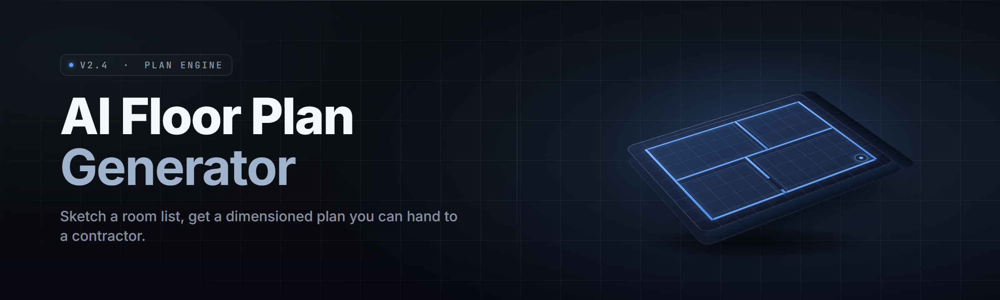

  
  
  

  

  
  
  

---

**A desktop .exe that turns a plain-English prompt, a photo, or a rough sketch into a buildable, code-compliant floor plan in under 90 seconds.**

The AI Floor Plan Generator is a standalone Windows application — no Python, no Node, no repo clone. You describe the space, it draws the plan. Walls, doors, windows, plumbing runs, egress paths, square footage — all of it, in a native `.exe` that runs offline on a mid-range laptop.

---

## Overview

| Category | Details |
|---|---|
| **Product name** | AI Floor Plan Generator |
| **Release year** | 2026 |
| **Distribution** | Standalone Windows `.exe` (portable + installer) |
| **Runtime** | Native C++ / DirectX 12 viewport, bundled ONNX inference |
| **Input modes** | Text prompt, floor-plan photo, hand sketch, DXF import |
| **Output modes** | 2D plan, 3D walkthrough, PDF sheet set, DXF, IFC |
| **Inference** | Fully offline — local model weights, no cloud round-trip |
| **Compliance** | IRC 2021 / IBC 2024 rule engine, region presets |
| **License** | MIT (engine), weights shipped under separate EULA |

The generator replaces the "open CAD, draw a wall, drag a door, repeat for four hours" loop with a conversational one. You type the room program — *"3 bed, 2 bath, 1800 sqft, open kitchen, south-facing patio"* — and the engine lays out a plan you can edit, not a picture you can only look at. Every wall it draws is a real wall with a thickness, a material tag, and a code check attached.

## Table of Contents

- [Overview](#overview)
- [What is the AI Floor Plan Generator?](#what-is-the-ai-floor-plan-generator)
- [Key Features](#key-features)
- [Is it safe to run?](#is-it-safe-to-run)
- [The Problem](#the-problem)
- [The Solution](#the-solution)
- 

  

(#download)
- [Quick Start](#quick-start)
- [Module Catalog](#module-catalog)
- [Compatibility / platform support](#compatibility--platform-support)
- [System Requirements](#system-requirements)
- [Known Issues](#known-issues)
- [Usage guidelines](#usage-guidelines)
- [FAQ](#faq)
- [Closing](#closing)

## What is the AI Floor Plan Generator?

| Term | Explanation |
|---|---|
| **Prompt-to-plan** | The core feature — a text description becomes a topologically valid layout, not a generated image. |
| **Wall graph** | The internal data structure: every wall is an edge, every room a face. Editable, measurable, exportable. |
| **Rule engine** | A deterministic compliance layer that flags egress width, door swing clearance, and min room dims. |
| **Program solver** | Places rooms against your sqft budget and adjacency constraints (kitchen near dining, bath near beds). |
| **Sheet set** | The PDF export: dimensioned plan, elevations, door/window schedule, title block. |
| **Reference image** | A photo or sketch you feed in — the engine traces walls and infers scale from a known door width. |
| **Weight pack** | The offline model bundle (`.onnx`) that ships with the `.exe`; swappable for regional styles. |

Why builders keep it installed:

- You get a **first draft in seconds**, not a blank canvas.
- Every output is **editable geometry** — not a raster you have to redraw.
- **Code checks run as you draw**, so you catch a too-narrow hallway before the client sees it.
- **Offline by default** — client plans never leave the machine.
- **DXF and IFC export** drop straight into the CAD stack you already use.

## Key Features

| Feature | Description | Benefit |
|---|---|---|
| Prompt-to-plan | Text program → full layout in one pass | First draft in <90s |
| Photo trace | Feed a listing photo, get wall geometry | Digitize existing homes |
| Sketch import | Phone photo of a hand drawing → scaled plan | Field-to-desk in one step |
| Rule engine | IRC/IBC checks with live redlining | Catch errors pre-submit |
| 3D walkthrough | First-person preview of the layout | Client-ready visual |
| DXF/IFC export | Round-trip to AutoCAD, Revit, SketchUp | Fits existing workflow |
| Sheet set PDF | Dimensioned plan + schedules | Permit-ready output |
| Furniture fill | Auto-places furniture to scale | Realistic spatial feel |
| Plumbing stacks | Routes wet walls sensibly | Fewer contractor callbacks |
| Egress solver | Validates window/door egress paths | Life-safety compliant |
| Region presets | Metric/imperial, regional code sets | Works outside the US |
| Undo history | Full graph-level undo/redo | Experiment without fear |

## Is it safe to run?

Yes. The `.exe` is a signed, self-contained native binary. It makes **no network calls during planning** — inference is local, weights ship in the binary's data folder. The only time it touches the network is the optional one-click update check, which you can disable in `Settings → Network`. No telemetry, no account, no cloud upload of your plans. Antivirus false positives are possible on freshly-built unsigned dev builds; the release build is code-signed.

## The Problem

- **Blank-canvas paralysis.** CAD tools hand you an empty grid and zero direction. The hard part was never drawing the wall — it was deciding where it goes.
- **Slow first drafts.** A residential schematic takes hours before it's even worth showing a client.
- **Code checks come last.** You draw the whole thing, then discover the bathroom door swings into the toilet.
- **Photos and sketches don't convert.** That listing photo or napkin drawing stays a photo or a napkin drawing.
- **Cloud tools leak plans.** Uploading a client's home to a web generator is a privacy problem nobody signed off on.
- **Rigid templates.** Drag-and-drop templates give you the same five layouts everyone else has.
- **Export friction.** Even when a tool makes a plan, getting it into CAD is a manual re-draw.

## The Solution

| Problem | Solution |
|---|---|
| Blank-canvas paralysis | Program solver proposes a full layout from your prompt |
| Slow first drafts | Plan generated in <90 seconds, editable immediately |
| Code checks come last | Rule engine redlines live as you draw |
| Photos/sketches don't convert | Photo trace + sketch import produce real wall geometry |
| Cloud tools leak plans | Fully offline inference, no upload |
| Rigid templates | Constraint-based solver, not fixed templates |
| Export friction | Native DXF/IFC/PDF export, no re-draw |

## Download

  

## Quick Start

1. 📄 **Get the archive** — grab the `.exe` release from the project page above.
2. 📦 **Extract** — right-click the `.zip`, choose *Extract All*. Keep the `model/` folder next to the `.exe`.
3. ▶️ **Run it** — double-click the `.exe`. First launch unpacks weights (~2 min).
4. 📝 **Describe your space** — type the program, or drop in a photo/sketch.
5. 💾 **Edit and export** — tweak the plan, then export DXF, IFC, or a PDF sheet set.

## Module Catalog

### 🏗️ Layout Engine

**Program solver** — Assigns rooms to a grid against sqft budget and adjacency rules.
**Wall graph builder** — Turns solver output into an editable edge/face structure.
**Constraint pass** — Enforces min room dims, circulation width, and door clearances.
**Topology repair** — Fixes orphaned rooms and dead-end corridors automatically.
**Grid snap** — Aligns geometry to a configurable structural grid.

### 📐 Geometry & Drafting

**Dimension engine** — Auto-dims walls, openings, and offsets in your unit system.
**Door/window schedule** — Generates a tagged, exportable opening schedule.
**Layer manager** — Standard AIA-ish layer set out of the box.
**Snap & ortho** — CAD-grade snapping for manual edits.
**Hatch fill** — Material-tagged hatching for poché on export.

### 🧾 Compliance & Code

**IRC 2021 checks** — Egress, stair, and clearance rules.
**IBC 2024 checks** — Commercial-side rule set.
**Egress solver** — Validates every sleeping room has a legal egress path.
**Occupancy calc** — Square-footage-per-occupant math for commercial plans.
**Region presets** — Metric/imperial and regional code variants.

### 🖼️ Input & Import

**Prompt parser** — NLP front-end that reads plain-English programs.
**Photo trace** — Detects wall lines in a listing photo, infers scale.
**Sketch import** — Corrects perspective on a phone photo of a hand drawing.
**DXF import** — Brings existing CAD geometry into the graph.
**Measurement tool** — Infers scale from a known reference (a 36" door).

### 🖥️ Viewport & Preview

**2D plan view** — The editing surface, GPU-accelerated.
**3D walkthrough** — First-person flythrough of the layout.
**Furniture fill** — Auto-populates rooms with to-scale furniture.
**Daylight preview** — Sun-angle study for window placement.
**Section cut** — Horizontal slice preview for elevations.

### 📤 Export & Interop

**PDF sheet set** — Dimensioned plan, elevations, schedules, title block.
**DXF export** — Round-trips to AutoCAD and clones.
**IFC export** — BIM-standard handoff to Revit and ArchiCAD.
**PNG/SVG export** — Quick visuals for decks and email.
**BOM export** — Bill of materials: wall lengths, opening counts, finishes.

### ⚙️ System & Settings

**Undo history** — Graph-level undo/redo, unlimited depth.
**Weight pack manager** — Swap regional model packs.
**Network toggle** — Disable the update check entirely.
**Autosave** — Crash-safe recovery of in-progress plans.
**Unit system** — Metric/imperial switch, per-project.

### 🧩 Extensibility

**Rule script API** — Add custom compliance checks in a small DSL.
**Style packs** — Regional layout styles loaded from JSON.
**Batch mode** — Generate many plans from a CSV program list.
**Plugin folder** — Drop-in `.dll` modules for custom exporters.

### 📊 Module Status

| Module | Status | Description |
|---|---|---|
| Prompt parser | ✅ Working | Plain-English → program struct |
| Program solver | ✅ Working | Room assignment vs constraints |
| Wall graph builder | ✅ Working | Editable edge/face geometry |
| Constraint pass | ✅ Working | Dims, circulation, clearances |
| Topology repair | ✅ Working | Fixes orphaned rooms |
| Dimension engine | ✅ Working | Auto-dim in unit system |
| Door/window schedule | ✅ Working | Tagged exportable schedule |
| IRC 2021 checks | ✅ Working | Egress, stair, clearance |
| IBC 2024 checks | ✅ Working | Commercial rule set |
| Egress solver | ✅ Working | Sleeping-room egress paths |
| Occupancy calc | ✅ Working | Sqft-per-occupant math |
| Photo trace | ✅ Working | Wall-line detection from photo |
| Sketch import | ✅ Working | Perspective correction on sketches |
| DXF import | ✅ Working | CAD geometry into graph |
| Measurement tool | ✅ Working | Scale from known reference |
| 2D plan view | ✅ Working | GPU-accelerated editor |
| 3D walkthrough | ✅ Working | First-person preview |
| Furniture fill | ✅ Working | Auto-place to-scale furniture |
| Daylight preview | 🟡 Beta | Sun-angle study |
| Section cut | 🟡 Beta | Horizontal slice preview |
| PDF sheet set | ✅ Working | Plan + elevations + schedules |
| DXF export | ✅ Working | AutoCAD round-trip |
| IFC export | ✅ Working | BIM handoff |
| BOM export | ✅ Working | Wall/opening/finish counts |
| Rule script API | 🟡 Beta | Custom checks in DSL |
| Style packs | ✅ Working | Regional layout styles |
| Batch mode | 🟡 Beta | CSV → many plans |
| Plugin folder | 🟡 Beta | Drop-in exporter DLLs |
| Autosave | ✅ Working | Crash-safe recovery |
| Weight pack manager | ✅ Working | Swap regional models |
| Network toggle | ✅ Working | Fully disable update check |
| Undo history | ✅ Working | Graph-level undo/redo |
| Unit system | ✅ Working | Metric/imperial per project |
| Layer manager | ✅ Working | Standard layer set |
| Snap & ortho | ✅ Working | CAD-grade snapping |
| Hatch fill | ✅ Working | Material-tagged poché |
| Plumbing stacks | 🟡 Beta | Wet-wall routing |
| PNG/SVG export | ✅ Working | Deck-ready visuals |
| Grid snap | ✅ Working | Structural grid align |
| Region presets | ✅ Working | Code + unit variants |

## Compatibility / platform support

| Platform | Support | Notes |
|---|---|---|
| Windows 11 (x64) | ✅ Full | Primary target |
| Windows 10 21H2+ (x64) | ✅ Full | DirectX 12 required |
| Windows on ARM | 🟡 Emulation | Runs via x64 emulation, slow |
| macOS | ❌ Not supported | No native build |
| Linux | ❌ Not supported | No native build |
| GPU (NVIDIA) | ✅ Full | DX12, driver 5xx+ |
| GPU (AMD) | ✅ Full | DX12, driver 2024+ |
| GPU (Intel Arc) | 🟡 Beta | Some viewport artifacts |

## System Requirements

| Component | Minimum | Recommended |
|---|---|---|
| OS | Windows 10 21H2 x64 | Windows 11 23H2 x64 |
| CPU | 4-core 2.5 GHz | 8-core 3.5 GHz |
| RAM | 8 GB | 16 GB |
| GPU | DX12, 2 GB VRAM | DX12, 6 GB VRAM |
| Storage | 4 GB free (SSD) | 8 GB free (NVMe) |
| Display | 1920×1080 | 2560×1440 |
| Inference | CPU-only fallback | GPU-accelerated |

## Known Issues

| Issue | Fix |
|---|---|
| First launch takes 2+ min | One-time weight unpack; subsequent launches are instant |
| Viewport stutter on Intel Arc | Disable *Settings → Viewport → Hardware AA* |
| Photo trace mis-scales without a door | Use Measurement Tool to set reference width |
| IFC export missing room names | Enable *Export → IFC → Tag Rooms* |
| Antivirus flags unsigned dev build | Use the signed release, or whitelist the folder |
| 3D walkthrough dark on laptops | Force discrete GPU in Windows Graphics settings |

## Usage guidelines

| Allowed | Not allowed |
|---|---|
| Residential and commercial planning | Using output as a stamped, sealed permit set |
| Client presentations and early concepts | Reselling the model weights |
| Digitizing your own listing photos | Digitizing photos you don't have rights to |
| Educational and hobbyist projects | Claiming AI output is a licensed architect's work |
| Batch-generating concept plans | Bypassing local code review |
| Modifying rule scripts for your region | Redistributing the `.exe` as your own product |

## FAQ

Do I need an internet connection?

No. Inference is fully offline. The only network call is the optional update check, which you can disable in Settings.

Does it work on Steam?

No — this is a standalone desktop `.exe`, not a Steam title. You download, extract, and run it directly.

Can I use the output for a real building permit?

The plan is a strong first draft, but a licensed architect or engineer must review and stamp anything you submit for permit. The rule engine helps you pass review, it doesn't replace it.

Which CAD tools can I export to?

DXF round-trips to AutoCAD and clones; IFC hands off to Revit and ArchiCAD. PDF and SVG cover decks and email.

How accurate is photo trace?

Good for clear, straight-on listing photos. Accuracy depends on a visible reference — set one with the Measurement Tool for reliable scale.

**Q:** Is there a Mac or Linux version?

**A:** No native build. Windows 10/11 x64 only. Windows-on-ARM runs it via emulation, slowly.

**Q:** Can I add my own compliance rules?

**A:** Yes — the Rule Script API lets you write custom checks in a small DSL, loaded from the plugin folder.

**Q:** Does it upload my plans anywhere?

**A:** Never. No account, no telemetry, no cloud. Plans stay on your machine.

**Q:** How big is the download?

**A:** The `.exe` plus weight pack is roughly 3–4 GB, mostly model weights.

## Closing

The AI Floor Plan Generator exists because the slow part of planning was never the drawing — it was the deciding. It ships as a single `.exe`, runs offline, and hands you editable geometry instead of a picture. Describe the space, get the plan, edit it, export it, hand it to someone who stamps it. That's the whole loop.

  

